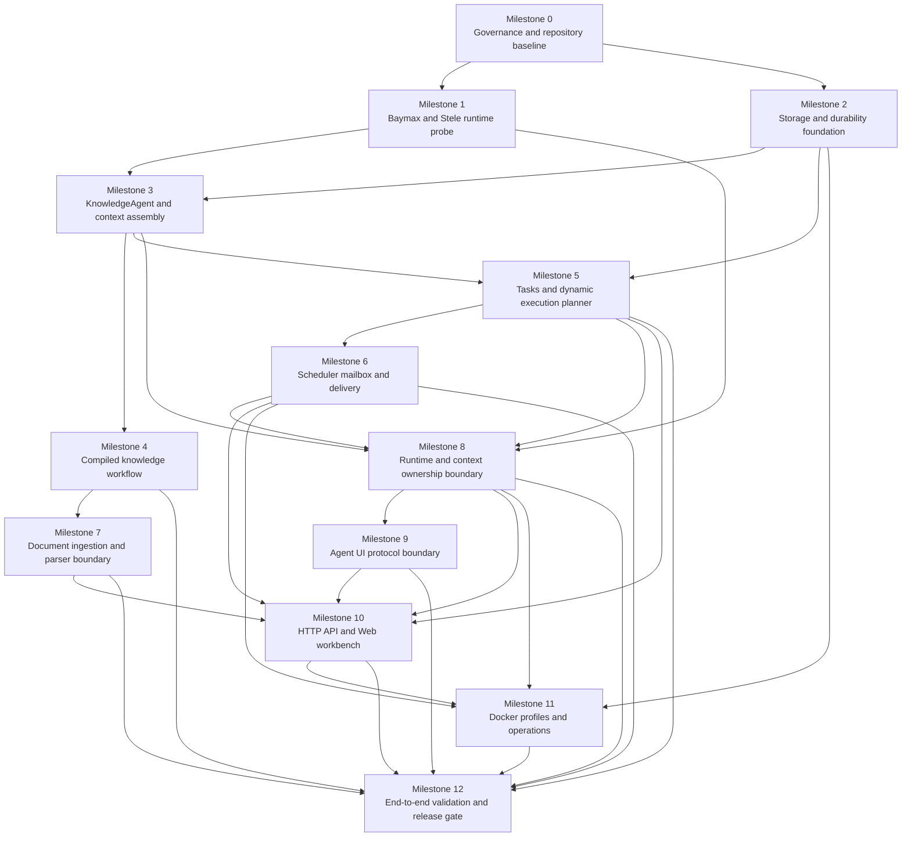

# Personal Knowledge and Task Agent Roadmap

> This roadmap turns the approved product design into a sequence of independently verifiable milestones. Each milestone produces a usable foundation for the next one. Detailed implementation plans are created separately after the milestone's scope and upstream dependencies are clear.

## Source design

The roadmap is derived from:

[Personal Knowledge and Task Agent Design](./superpowers/specs/2026-10-04-personal-knowledge-task-agent-design.md)

The project validates Baymax and Stele through real workflows. Baymax remains the Agent runtime and orchestration owner. Stele remains the context source and memory store. The application owns product entities, persistence boundaries, authorization policy, and the Web/API control surface.

## Delivery principles

1. **Runtime evidence before product breadth.** A feature is not considered integrated until its Baymax and Stele behavior is demonstrated through a deterministic test and a real OpenAI-compatible smoke run where applicable.
2. **One domain Agent, dynamic execution shape.** Query, compilation, task work, and scheduled instructions use one KnowledgeAgent domain with explicit policies. An ExecutionPlanner chooses direct, subagent, team, workflow, mailbox, or scheduled execution from the task profile.
3. **Baymax owns execution mechanics.** The application does not reimplement Baymax Run/Stream, subagent budgets, team aggregation, mailbox lifecycle, scheduler leases, Context Assembler state, or terminal-event semantics.
4. **Stele owns context continuity.** The application stores references and projections through a Stele adapter. It does not duplicate Stele internals in business modules.
5. **No production workaround for upstream defects.** A behavior that requires a Baymax or Stele change is recorded in the corresponding findings document and blocks dependent work until an upstream release or pinned reviewable commit fixes it.
6. **Durability before scale.** Cross-store boundaries use database transactions, durable outboxes, idempotency keys, manifests, and startup reconciliation before adding more Agent modes.
7. **Local-first security is explicit.** The unauthenticated MVP binds to loopback. A non-loopback deployment is rejected until an authenticated mode with authorization and request-forgery protection exists.
8. **Ownership is explicit.** Baymax owns generic execution mechanics; Stele owns memory retrieval and context continuity; Danny owns product entities, authorization, durable cross-store commits, and user-facing projections. A boundary cannot be copied into Danny merely because a product feature needs it.
9. **The browser consumes product projections.** The workbench consumes Danny-owned execution and context projections. It never depends on Baymax internal event types or Stele internal records, and a UI action never bypasses Danny authorization, revision, or idempotency checks.

## Dependency map

Milestones 1 and 2 can proceed in parallel after Milestone 0. The runtime probe must complete before any feature claims Baymax/Stele integration. The storage foundation must complete before tasks, schedules, or compilation durability is implemented.

## Milestone 0 — Governance and repository baseline

**Purpose:** establish the repository structure, dependency policy, local security boundary, and evidence conventions before implementing product behavior.

**Deliverables:**

- Go module and service entry-point layout for `cmd`, `server`, `agent`, `context`, `knowledge`, `tasks`, `storage`, and `web`.
- Initial configuration model for model endpoint, Baymax/Stele versions, storage driver, data directories, listener address, scheduler, and Docker profiles.
- `docs/upstream/baymax-findings.md` and `docs/upstream/stele-findings.md` using the approved structured finding template.
- Dependency lock policy recording exact Baymax and Stele versions or commits.
- Default listener and Docker port binding set to `127.0.0.1`.
- CI skeleton for formatting, static checks, unit tests, and documentation checks.
- A small deterministic fixture corpus for documents, tasks, schedules, and Agent events.

**Entry conditions:** the approved design document is committed.

**Exit gate:**

- The repository builds with the selected Go toolchain.
- Configuration rejects non-loopback binding unless the future authenticated mode is enabled.
- The two upstream findings documents exist and define the `blocked-upstream` lifecycle.
- Dependency versions are reproducible from a clean checkout.
- No application code calls a provider SDK directly.

**Next implementation plan:** repository bootstrap and configuration boundaries.

## Milestone 1 — Baymax and Stele runtime probe

**Purpose:** prove the core dependencies can be used through their real APIs before building business features around assumptions.

**Baymax evidence:**

- A real parent Run and Stream using the configured model adapter.
- A typed local tool invocation and lifecycle event capture.
- A bounded child run through Baymax composer/subagent dispatch.
- A minimal `teams` parallel run and a vote run.
- A mailbox command publish, lease consume, ack, requeue, and dead-letter fixture.
- A scheduler lease and delayed-dispatch fixture.
- A Context Assembler projection with prefix guard, handoff digest, and derived budget view.

**Stele evidence:**

- Create and read a scoped conversation context.
- Append and query a long-term memory.
- Attach a task and run reference to context.
- Reconstruct a bounded context projection after process restart.
- Verify the idempotency behavior required for scheduled memory writes.

**Deliverables:**

- `agent/baymax` adapter with no business logic.
- `context/stele` adapter exposing domain operations only.
- Correlation model for parent run, child run, team, mailbox message, schedule occurrence, and Stele context.
- Deterministic fake-model fixtures plus an OpenAI-compatible live smoke fixture.
- First entries in upstream findings documents for any observed defect or missing contract.

**Exit gate:** all runtime paths above produce correlated evidence. If a required capability is missing or incorrect in Baymax or Stele, dependent milestones are marked `blocked-upstream` and no production workaround is added.

**Next implementation plan:** dependency adapters and integration contract tests.

## Milestone 2 — Storage and durability foundation

**Purpose:** create the persistence model needed to make compilation, scheduling, task updates, and delivery recoverable.

**Deliverables:**

- Storage interfaces and SQLite implementation.
- PostgreSQL implementation using the same repositories and migrations.
- Database migrations for conversations, tasks, schedules, executions, notifications, source metadata, knowledge generations, artifacts, manifests, revisions, idempotency records, leases, and outboxes.
- Transactional outboxes for:
  - schedule dispatch to Baymax mailbox;
  - Stele context projection;
  - Webhook delivery.
- Startup reconciliation for pending outbox rows, expired leases, incomplete materialization, and committed knowledge generations.
- A generation manifest model with a monotonic generation ID and commit marker.
- Effect-key repository for conditional idempotent mutations.

**Knowledge durability rule:** SQLite/PostgreSQL is the source of truth for committed source bytes and generated artifacts. The mounted filesystem is an input directory and derived export. Readers use committed database generations only.

**Exit gate:**

- SQLite and PostgreSQL pass the same repository contract suite.
- A crash at each documented transaction boundary leaves either the previous committed state or the complete new state.
- Outbox rows survive process restart and are safe to publish again with the same idempotency key.
- Materialization can be deleted and rebuilt from a committed generation manifest.

**Next implementation plan:** repositories, migrations, transaction boundaries, outbox workers, and reconciliation.

## Milestone 3 — KnowledgeAgent and Context Assembler integration

**Purpose:** build the unified KnowledgeAgent and ensure every parent and child receives a bounded, role-specific Stele projection through Baymax Context Assembler.

**Deliverables:**

- KnowledgeAgent construction with `read`, `write`, and `scheduled` policies.
- Server-controlled tool registration and capability checks.
- `ExecutionPlanner` interfaces for `TaskProfile`, `ExecutionPlan`, plan digest, and plan version.
- Context projection pipeline:
  - prefix baseline and capability digest;
  - Stage 2 Stele/KnowledgeStore disclosure;
  - pressure compaction and task-aware recap;
  - reference-first `handoff.v1`.
- Role-specific projections for coordinator, ContextReader, KnowledgeNavigator, SectionAnalyst, CitationValidator, and TaskMemoryInterpreter.
- Baymax event and diagnostic projection into application execution records and Stele references.
- Prompt-injection boundary tests proving untrusted data cannot authorize write tools.

**Execution modes initially supported:** `direct` and bounded `subagent_fanout`. Team, workflow, mailbox, and scheduled modes are added by later milestones after their planner contracts are in place.

**Exit gate:**

- Run and Stream produce equivalent terminal and aggregation semantics.
- A child cannot run with a different prefix or tool capability digest than its authorized parent projection.
- Context pressure preserves citations and source references.
- Stele is never copied wholesale into every child prompt.
- Untrusted document text cannot invoke memory, task, schedule, webhook, or compilation side effects.

**Next implementation plan:** unified Agent runtime, policy-controlled tools, Context Assembler adapter, and projection tests.

## Milestone 4 — Compiled knowledge workflow

**Purpose:** implement the OpenKB-inspired knowledge workbench foundation: import documents, compile durable artifacts, navigate them, and answer with citations.

**Deliverables:**

- Markdown and plain-text scanner with content hashing and incremental change detection.
- Normalizer and heading-based section-tree extraction.
- Knowledge artifacts:
  - source document;
  - summary page;
  - concept page;
  - entity page;
  - section tree;
  - knowledge index;
  - saved exploration.
- Baymax workflow for normalize → fan out section subagents → aggregate findings → validate citations → prepare plan → commit generation.
- Baymax teams parallel aggregation for independent sections and vote validation for conflicting concepts or citations.
- Database generation commit, filesystem materialization, and Stele context outbox.
- Knowledge navigation tools: index, summary, concept, entity, candidate search, and bounded source section reads.
- Citation model with source identity, section range, generation ID, and artifact lineage.

**Exit gate:**

- Two Markdown documents compile into browsable artifacts.
- Cross-document concept updates are visible and source-linked.
- A query follows index → summary/concept/entity → bounded source section and returns citations.
- Unsupported claims are rejected before commit.
- Crashing during staging or materialization never exposes a partial generation.

**Next implementation plan:** ingestion, KnowledgeStore generation model, compiler workflow, navigation tools, and citation validation.

## Milestone 5 — Tasks and dynamic execution planner

**Purpose:** support personal tasks and choose Baymax's execution shape from task characteristics at runtime.

**Deliverables:**

- Task entity with title, description, status, due time, labels, source conversation, run links, and monotonic revision.
- Conditional task mutations using `expected_revision`.
- Typed `task_revision_conflict` response and Agent re-read/replan behavior.
- TaskProfile extraction for objective, complexity, dependency graph, parallelism, evidence breadth, latency, risk, write scope, and budget.
- Deterministic planner rules and versioned ExecutionPlan:
  - `direct`;
  - `subagent_fanout`;
  - `team_parallel`;
  - `team_vote`;
  - `workflow`;
  - `mailbox_async`;
  - `scheduled`.
- Harness control loop with admission, plan notebook, checkpoints, safe-point pause, bounded retry, replan, and commit gate.
- Plan-versioned replan that reuses completed idempotent results and cannot silently expand write authority.

**Exit gate:**

- Equivalent profiles choose equivalent modes and record rationale.
- Low-complexity tasks use direct execution.
- Independent work uses subagents or parallel teams within parent budget.
- Ordered or commit-sensitive work uses workflow checkpoints.
- Long-running work uses mailbox delivery and can resume after restart.
- Concurrent stale task writes produce a revision conflict rather than lost updates.
- `input_required`, `approval_required`, and `budget_exhausted` pause reasons resume from a durable checkpoint.

**Next implementation plan:** task repositories, planner rules, plan notebook, harness controller, and concurrency tests.

## Milestone 6 — Scheduler, mailbox, and reliable delivery

**Purpose:** add fixed-action and natural-language scheduled tasks with durable dispatch, idempotent effects, explicit time semantics, and notifications.

**Deliverables:**

- Schedule definitions with cron, IANA timezone, action type, instruction/payload, enabled state, retry policy, misfire policy, and backfill limit.
- Schedule occurrence identity containing local timestamp, resolved UTC instant, tzdata version, and schedule revision.
- Baymax scheduler integration for lease, retry, QoS, delayed dispatch, and DLQ.
- Application schedule dispatch outbox and Baymax mailbox worker.
- Occurrence-scoped effect keys for every scheduled mutation.
- Conditional idempotent writes for tasks, memories, compilation, notifications, and Stele operations.
- DST behavior:
  - skip nonexistent local times;
  - select the earlier UTC instant for ambiguous local times;
  - record the decision.
- Misfire policies:
  - `skip`;
  - default `coalesce_latest`;
  - bounded `backfill`.
- Web notifications and durable Webhook delivery outbox with independent retry worker.

**Exit gate:**

- A natural-language schedule creates a real Baymax scheduled run and Stele memory.
- A fixed reminder survives scheduler and worker restart.
- Crash windows around occurrence commit and mailbox publish deliver one logical occurrence.
- Replayed scheduled side effects return the original effect result.
- DST and misfire fixtures produce stable occurrence decisions and keys.
- Webhook delivery survives a crash after execution and reports terminal failure separately from Agent success.
- Missing Stele idempotency support blocks the dependent feature rather than introducing a production workaround.

**Next implementation plan:** schedule repositories, occurrence calculator, outbox worker, mailbox worker, effect-key enforcement, and delivery worker.

## Milestone 7 — Document ingestion and parser boundary

**Purpose:** define and validate the OpenKB-inspired document ingestion boundary before exposing file upload through the HTTP workbench. The parser runs as an isolated service so Go business modules do not depend on Python document libraries or implicit system CLI behavior.

**OpenKB-derived support contract:**

- Markdown and plain text are required local formats.
- HTML and CSV are required local formats.
- DOCX, PPTX, XLSX, and XLS are supported through the parser image's pinned `markitdown` extras.
- PDF is supported through PyMuPDF; long PDF routing uses a configurable page threshold.
- PageIndex Cloud OCR/import is optional and must be observable as a provider mode with explicit fallback or failure status.
- Unknown extensions, missing parser extras, resource-limit violations, and malformed documents return structured `unsupported` or `failed` states.

**Deliverables:**

- Versioned parser service HTTP contract for staging-object submission, status, result retrieval, cancellation, health, and capability discovery.
- Production Go-to-Python transport uses versioned HTTP/JSON over the internal network; a CLI adapter over the same parser core is required for local development, deterministic fixtures, and diagnostics.
- Canonical parsed document model containing source fingerprint, content hash, detected format, parser/provider version, Markdown, page/section metadata, image references, warnings, and failure details.
- Resource policy for file size, page count, CPU, memory, concurrency, timeout, temporary storage, and cleanup.
- Untrusted-source marker carried into KnowledgeAgent context and tool policy.
- SQLite/PostgreSQL source metadata and generation input records for parser jobs.
- Parser Docker image, Compose profile, health/readiness checks, and loopback-only default exposure.
- Deterministic fixtures for every supported format, malformed input, parser crash/restart, duplicate content, and optional PageIndex Cloud fallback.

**Exit gate:**

- Every required format reaches canonical Markdown or a persisted structured failure.
- Repeating a request with the same source fingerprint is idempotent and returns the same parsed artifact.
- Parser restart does not lose accepted jobs or leave an untracked temporary file.
- Go compilation consumes only the versioned parser contract and never imports parser implementation packages.
- Source text is marked untrusted before Baymax context assembly and cannot expand write capabilities.
- Local mode works without PageIndex credentials; cloud mode is opt-in and records provider/fallback evidence.

**Next implementation plan:** parser contract, Python adapter, resource limits, job persistence, Docker profile, and format/failure fixtures.

## Milestone 8 — Runtime and context ownership boundary

**Status (2026-11-12): implementation evidence is substantially complete, but the exit gate is not passed.** Dependencies were refreshed to both upstream remote HEADs (Baymax `cca95f31f71b`, Stele `19fc90134492`); `go build ./...`, `go test ./...` and the pinned owner-store/continuation fixtures pass on the new pins. Danny now wires the new Baymax owners instead of only inspecting them: `BindOwnerStore` binds `core/history.OpenOwnerStore` for execution and for `Reconcile` replay, and `BindContinuationOwners` binds durable child, team and mailbox continuation owners with a fresh-process restore reproduction for each of `input_required`, `approval_required` and `budget_exhausted`. The first of the two Baymax findings is resolved; the second is narrowed to the missing live gate. The capability manifest still marks child/team pause restore `unsupported` because promotion requires the real integration path. Stele adds `corrections` to `ProviderCapabilityDocument.required` plus versioned context projection specs, and the Stele `f38016e` live-service evidence still does not cover the current pin. The live harness is no longer the gap, and neither is the provider credential: on 2026-11-12 `cmd/runtime-probe live-smoke` ran against a real OpenAI-compatible gateway (`agnes-3.0-flash` over `POST /v1/responses`) and all six forms passed through the authorized adapter, recorded in `testdata/runtimeprobe/baymax-live-smoke.evidence.json`. That bundle carries `"provider_compat": "stream-field-injected"` because the gateway mis-handles an omitted `stream` field, so it is real evidence with a documented adaptation, not a clean conformance run. Two things still block the exit gate: the Stele case in that bundle is `skipped-unconfigured` (no pinned Stele service has been run on the current pin), and live pause restore was not exercised, which is why child/team pause restore stays `unsupported`. Milestone 9 handoff remains deferred until task 7.3 is completed with real Stele evidence.

**Purpose:** make the Baymax execution plane, Stele context plane, and Danny product control plane explicit before exposing either one through a browser. This milestone moves generic runtime responsibilities toward their upstream owners through public contracts and evidence; it does not move Danny's task, knowledge, schedule, authorization, or commit authority into either dependency.

**Baymax boundary:**

- Baymax owns Run/Stream execution, tool invocation, child runs, teams, workflows, mailbox mechanics, checkpoint/resume, safe points, retry/cancel/timeout, terminal semantics, and native execution event ordering.
- Danny owns admission, task revision, policy and write scope, plan selection, effect keys, application commit gates, and business correlation fields.
- The Danny adapter consumes Baymax's public event and recovery surface instead of synthesizing a second execution lifecycle.

**Stele boundary:**

- Stele owns scoped memory, retrieval and ranking, context assembly and budget selection, provenance, memory paths, idempotent memory writes, sessions, turns, and context continuity.
- Danny owns source trust classification, role and tool authorization, product references, task and generation authority, and the policy that decides whether a Stele result may enter a write-capable run.
- Danny consumes bounded structured references and provenance through the Stele adapter; it does not copy Stele internals into business modules.

**Deliverables:**

- A versioned Baymax execution-host contract for Danny `ExecutionPlan` projection, parent/child correlation, teams, workflows, mailbox continuation, checkpoints, resume, safe points, retry, terminal outcomes, and event cursors.
- A Danny adapter that records real Baymax execution events and recovery evidence, with Run/Stream terminal and aggregation parity.
- A versioned Stele context contract for scoped query, role/policy hints, context budget, bounded references, provenance, selection metadata, projection digest, and idempotent writes.
- A Stele adapter that uses native context and memory capabilities where the public contract supports them, while keeping Danny's untrusted-source and tool policy at the application boundary.
- An ownership matrix mapping every current runtime, context, scheduler, task, knowledge, and delivery responsibility to Baymax, Stele, or Danny.
- Contract tests and pinned dependency evidence for event replay, checkpoint recovery, bounded context assembly, restart projection, and idempotent memory effects.
- Upstream findings for any missing or incorrect Baymax/Stele capability. A dependent task is marked `blocked-upstream` when the required public contract cannot be verified; no local production workaround is introduced.

**Exit gate:**

- Baymax produces correlated native execution events for direct, child, team, workflow, and mailbox paths, and a reconnect can resume from a durable cursor without changing terminal semantics.
- Checkpoint and resume preserve plan version, capability digest, projection digest, write scope, and completed effect keys.
- Danny no longer needs to define a competing execution lifecycle for a capability already provided by Baymax; remaining Danny state is product authority or a durable application commit.
- Stele returns bounded, scoped, provenance-carrying context and honors its documented idempotency behavior across restart.
- Danny does not treat Stele content as authorization, and source text remains marked untrusted before a write-capable Agent run.
- Any upstream limitation has a Chinese finding with reproduction, evidence, affected roadmap task, and unblock condition; unresolved blockers are excluded from the next milestone's feature claims.

**Next implementation plan:** Baymax execution-host adapter, Stele context contract, ownership matrix, migration evidence, and upstream boundary findings.

## Milestone 9 — Agent UI protocol boundary

**Purpose:** establish a stable browser-facing projection for Agent execution and controlled dynamic UI before implementing the full HTTP workbench. AG-UI is used for execution events; A2UI is used for declarative forms and interaction cards. Neither protocol becomes the source of truth for Danny tasks, memory, schedules, or business side effects.

**AG-UI event projection:**

- Map Danny execution records and verified Baymax events to a Danny-owned AG-UI-compatible event stream.
- Support event IDs, ordered sequences, terminal events, reconnect cursors, replay, cancellation status, and refresh reconciliation.
- Include typed projections for Agent output, tool calls, child runs, teams, workflows, mailbox state, planner decisions, checkpoints, citations, and failures.
- Keep Baymax event types behind the adapter so the React client does not import Baymax packages or internal event structures.

**A2UI dynamic surface:**

- Use A2UI `v0.9.1` for the first dynamic form and interaction-card trial because it is the current production version and the React renderer is marked Stable for that version.
- Define a restricted Danny catalog containing only server-registered components and actions. Model-generated component names, functions, and props never become executable by default.
- Validate every action on the server using execution ID, surface ID, surface revision, action ID, user activation, schema, authorization policy, task revision, and an idempotency key.
- Treat labels, options, source excerpts, retrieved memory, and imported documents as untrusted data. A2UI actions cannot expand Baymax tool capabilities or bypass Danny commit gates.
- Keep an internal `DynamicSurface` and `SurfaceAction` model so a future A2UI v1.0 adapter can be added without changing Agent runtime or business APIs.

**Version and scope policy:**

- As checked on 2026-10-09, the [A2UI specification versions](https://a2ui.org/#specification-versions) page marks v1.0 as Candidate/Release candidate, with a [roadmap target of Q4 2026](https://a2ui.org/roadmap/) and no committed release date.
- The v1.0 roadmap includes protocol stability, v0.9 migration guidance, a complete test suite, and renderer certification. Danny must not claim v1.0 support until the release and the React renderer support are verified.
- The [v1.0 evolution guide](https://a2ui.org/specification/v1.0-evolution-guide/) describes action responses, action IDs, `surfaceProperties`, bidirectional function calls, catalog ownership, extension metadata, and caller authorization.
- The [renderer status](https://a2ui.org/reference/renderers/) lists React support for v0.9.1 as Stable and v1.0 as Planned; verify this status again when implementing or upgrading the renderer.
- MCP-UI/MCP Apps remains deferred as an external MCP tool UI integration. It is not a replacement for the local React workbench in this milestone.

**Deliverables:**

- AG-UI-compatible SSE projection with replay and reconnect contract tests.
- A2UI v0.9.1 restricted catalog, React renderer compatibility fixture, server-side action validator, and revision/idempotency enforcement.
- `DynamicSurface`, `SurfaceAction`, and `SurfaceSubmission` application models independent of A2UI wire versions.
- Security tests proving imported or retrieved instructions cannot create a new action, invoke a tool, or submit a stale surface.
- A compatibility note documenting A2UI v0.9.1 support, the v1.0 Candidate status, Q4 2026 roadmap target, and the conditions for upgrading.

**Exit gate:**

- A browser client can reconnect to a running execution and converge on the same terminal state without duplicate logical side effects.
- AG-UI projections cover Baymax execution modes without exposing Baymax internals to the client.
- A2UI v0.9.1 can render a server-approved form and interaction card, and an action reaches Danny's authorization and idempotency boundary before any mutation.
- Stale, replayed, unauthorized, malformed, and untrusted submissions are rejected with typed errors.
- No feature claim depends on A2UI v1.0 or an unverified React v1.0 renderer.

**Next implementation plan:** AG-UI/SSE event projection, A2UI catalog and action boundary, React compatibility fixture, and reconnect/security tests.

## Milestone 10 — HTTP API and Web workbench

**Purpose:** expose the verified domain capabilities through a local browser workbench.

**Deliverables:**

- Loopback-only HTTP server with same-origin state-changing request checks.
- Streaming chat endpoint that exposes the Milestone 9 AG-UI-compatible execution projection.
- Knowledge endpoints for directory configuration, indexing, artifact browsing, source sections, and index status.
- Task endpoints with revision-aware updates and conflict responses.
- Schedule endpoints with misfire/timezone configuration and execution history.
- Notification and Webhook delivery status views.
- Run inspector showing parent/child runs, plan versions, teams, mailbox states, leases, retries, DLQ, context projection digests, and Stele references.
- React + TypeScript + Vite workbench with OpenKB-like knowledge navigation, central chat, AG-UI event consumption, and the restricted A2UI v0.9.1 renderer from Milestone 9.

**Exit gate:**

- The browser can complete the documented knowledge, memory, task, schedule, notification, and citation scenarios through the API.
- Streamed AG-UI events and final state agree after refresh or reconnect.
- A stale UI update displays a revision conflict and cannot overwrite newer state.
- A dynamic A2UI form or card can request a permitted action, display a typed rejection, and never invoke a mutation directly from browser-provided component data.
- The UI cannot access the service from a non-loopback binding in the default profile.

**Next implementation plan:** HTTP resource contracts, React state model, AG-UI/A2UI client integration, workbench views, and browser security tests.

## Milestone 11 — Docker profiles and operations

**Purpose:** make the validated local system reproducible in Docker with SQLite and PostgreSQL modes.

**Deliverables:**

- Dockerfile for the application and Web assets.
- Docker Compose default profile with SQLite and mounted data/documents directories.
- PostgreSQL profile with database health checks and migrations.
- Separate app, scheduler, mailbox/outbox, materializer, and delivery worker processes where required by the runtime contract.
- Loopback-only host port publishing.
- Shared configuration for OpenAI-compatible endpoint and model credentials through environment variables.
- Startup reconciliation and health endpoints for database, Baymax, Stele, mailbox, outboxes, and materialized knowledge generation.
- Backup/export instructions for database generations, manifests, source files, and Stele data.

**Exit gate:**

- A clean machine can start the SQLite profile with one documented command.
- The PostgreSQL profile passes the same repository and end-to-end suites.
- Restarting each worker leaves pending work recoverable.
- Deleting the derived artifact export and restarting rebuilds it from the committed generation.
- No default container port is reachable beyond the local machine.

**Next implementation plan:** container build, Compose profiles, health checks, migration startup, and recovery smoke tests.

## Milestone 12 — End-to-end validation and release gate

**Purpose:** prove the project validates Baymax and Stele in real user workflows and is ready for the next development cycle.

**Required scenario suite:**

1. Import two Markdown documents and answer a cited question.
2. Save a personal preference to Stele and retrieve it in a new conversation.
3. Create, update, and complete a task across conversations with revision checks.
4. Run a daily natural-language summary schedule and save the result to memory.
5. Execute a fixed reminder with a failing Webhook and verify independent retry status.
6. Compile a multi-section document using subagents, parallel team aggregation, citation validation, and atomic generation commit.
7. Trigger dynamic planner choices for direct, subagent, team, workflow, mailbox, and scheduled modes.
8. Pause and resume a run from a harness checkpoint.
9. Crash at every documented outbox, lease, materialization, and webhook boundary and verify recovery.
10. Run the full suite in SQLite and PostgreSQL modes.
11. Run deterministic fake-model contract tests and an OpenAI-compatible live smoke test.
12. Import representative PDF, DOCX, PPTX, XLSX, XLS, HTML, CSV, TXT, and Markdown files through the parser service and verify canonical output or structured failure.
13. Verify all active Baymax/Stele findings have regression fixtures and that blocked tasks remain blocked until the upstream repair is verified.
14. Reconnect a browser during direct, child, team, workflow, mailbox, and scheduled runs; verify the AG-UI projection converges with the durable Danny execution record and terminal result.
15. Render a restricted A2UI v0.9.1 form and interaction card; verify stale, replayed, unauthorized, malformed, and untrusted submissions cannot create an effect or expand Agent authority.
16. Verify Baymax execution recovery and Stele bounded context/restart behavior through the contracts established in Milestone 8, including all documented upstream blockers.

**Release gate:**

- Unit, integration, and Docker end-to-end suites pass.
- Run and Stream semantics are equivalent at terminal and aggregation boundaries.
- No unresolved `blocked-upstream` dependency is included in the claimed feature set.
- The upstream findings documents contain version, reproduction, evidence, affected task, and unblock condition for every discovered issue.
- The design's durability claims are backed by crash-recovery tests rather than only in-process tests.
- Browser execution projections, dynamic UI actions, and durable product state agree across refresh, reconnect, retry, and restart boundaries.

## Upstream blocking policy

At every milestone, a Baymax or Stele issue that requires upstream behavior change follows this sequence:

1. Capture the exact dependency version or commit.
2. Reduce the issue to a deterministic test or fixture.
3. Record it in the correct document:
   - `docs/upstream/baymax-findings.md`
   - `docs/upstream/stele-findings.md`
4. Link the finding to every dependent roadmap task.
5. Mark those tasks `blocked-upstream`.
6. Stop dependent implementation; do not add a production workaround or silently weaken the acceptance condition.
7. Resume only after an upstream release or explicitly pinned reviewable commit is available.
8. Rerun the fixture and the affected integration suite.
9. Mark the finding `fixed-upstream` and unblock the dependent tasks only after the real integration path passes.

The only work allowed while a task is blocked is documentation, deterministic reproduction, diagnostic evidence, and tests that verify the required upstream behavior.

## How to use this roadmap

Each milestone should be executed as its own implementation plan with focused commits and a clear exit gate. The next plan is created only after the current milestone's gate passes, except for the explicitly parallel Milestone 1 and Milestone 2 work after Milestone 0.

The first implementation plan should cover Milestone 0 and Milestone 1 together only if the dependency probe can remain isolated from product code. Otherwise, complete Milestone 0 first, then create a separate Milestone 1 plan for the Baymax/Stele runtime evidence.
