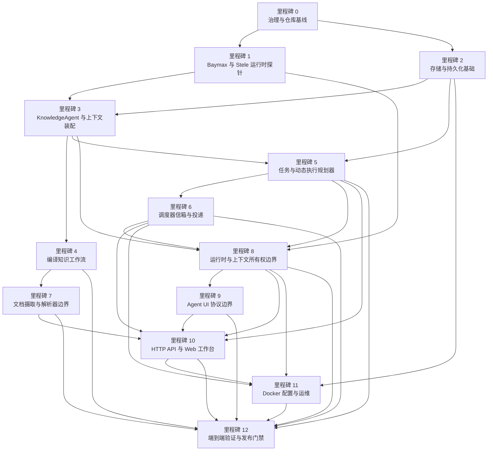

# 个人知识与任务 Agent 路线图

> 本路线图将已批准的产品设计转化为一系列可独立验证的里程碑。每个里程碑都为下一个里程碑产出可用的基础。详细实现计划在该里程碑的范围与上游依赖明确之后单独创建。

## 源设计

本路线图源自：

[个人知识与任务 Agent 设计](./superpowers/specs/2026-10-04-personal-knowledge-task-agent-design.md)

项目通过真实工作流验证 Baymax 与 Stele。Baymax 仍然是 Agent 运行时与编排的所有者。Stele 仍然是上下文来源与记忆存储。应用拥有产品实体、持久化边界、授权策略以及 Web/API 控制面。

## 交付原则

1. **先有运行时证据，再扩展产品广度。** 只有当某功能的 Baymax 与 Stele 行为通过确定性测试（在适用时还包括真实的 OpenAI 兼容冒烟运行）得到证明后，该功能才被视为已完成集成。
2. **单一领域 Agent，动态执行形态。** 查询、编译、任务工作与定时指令共用同一个 KnowledgeAgent 领域，并通过显式策略加以约束。ExecutionPlanner 根据任务画像选择直接、子 Agent、团队、工作流、信箱或定时执行。
3. **Baymax 拥有执行机制。** 应用不重新实现 Baymax Run/Stream、子 Agent 预算、团队聚合、信箱生命周期、调度器租约、上下文装配器状态或终止事件语义。
4. **Stele 拥有上下文连续性。** 应用通过 Stele 适配器存储引用与投影。它不会在业务模块中复制 Stele 的内部实现。
5. **不为上游缺陷添加生产绕过方案。** 需要修改 Baymax 或 Stele 的行为记录在相应的发现文档中，并阻塞依赖工作，直到上游发布或固定的可审查提交修复该问题。
6. **先持久化，后扩展规模。** 在添加更多 Agent 模式之前，跨存储边界使用数据库事务、持久化发件箱、幂等键、清单与启动校正。
7. **本地优先的安全策略是显式的。** 未认证的 MVP 绑定到环回地址。在存在带授权与请求伪造防护的认证模式之前，非环回部署会被拒绝。
8. **所有权是显式的。** Baymax 拥有通用执行机制；Stele 拥有记忆检索与上下文连续性；Danny 拥有产品实体、授权、持久化跨存储提交以及面向用户的投影。不能仅因为某个产品功能需要，就把边界复制进 Danny。
9. **浏览器消费产品投影。** 工作台消费 Danny 拥有的执行与上下文投影。它绝不依赖 Baymax 内部事件类型或 Stele 内部记录，UI 操作也绝不绕过 Danny 的授权、修订版本或幂等性检查。

## 依赖图

里程碑 1 与里程碑 2 可在里程碑 0 之后并行推进。在任何功能声称已完成 Baymax/Stele 集成之前，运行时探针必须完成。在实现任务、调度或编译持久化之前，存储基础必须完成。

## 里程碑 0 — 治理与仓库基线

**目的：** 在实现产品行为之前，建立仓库结构、依赖策略、本地安全边界与证据约定。

**交付物：**

- 面向 `cmd`、`server`、`agent`、`context`、`knowledge`、`tasks`、`storage` 和 `web` 的 Go 模块与服务入口布局。
- 初始配置模型，覆盖模型端点、Baymax/Stele 版本、存储驱动、数据目录、监听地址、调度器与 Docker 配置。
- 使用已批准的结构化发现模板的 `docs/upstream/baymax-findings.md` 与 `docs/upstream/stele-findings.md`。
- 记录 Baymax 与 Stele 精确版本或提交的依赖锁定策略。
- 默认监听地址与 Docker 端口绑定设置为 `127.0.0.1`。
- 用于格式化、静态检查、单元测试与文档检查的 CI 骨架。
- 面向文档、任务、调度与 Agent 事件的小型确定性测试夹具（fixture）语料库。

**进入条件：** 已批准的设计文档已提交。

**退出条件：**

- 仓库可用所选 Go 工具链构建。
- 除非启用未来的认证模式，否则配置拒绝非环回绑定。
- 两份上游发现文档已存在，并定义了 `blocked-upstream` 生命周期。
- 依赖版本可从干净检出中复现。
- 没有应用代码直接调用提供方 SDK。

**下一个实现计划：** 仓库引导与配置边界。

## 里程碑 1 — Baymax 与 Stele 运行时探针

**目的：** 在围绕假设构建业务功能之前，证明核心依赖可通过其真实 API 使用。

**Baymax 证据：**

- 使用所配置模型适配器的真实父 Run 与 Stream。
- 一次有类型的本地工具调用与生命周期事件捕获。
- 通过 Baymax composer/subagent 调度的一次有界子运行。
- 一次最小化的 `teams` 并行运行与一次投票运行。
- 信箱命令的发布、租约消费、确认（ack）、重新入队（requeue）与死信测试夹具（fixture）。
- 调度器租约与延迟调度测试夹具（fixture）。
- 带前缀守卫、交接摘要与派生预算视图的上下文装配器投影。

**Stele 证据：**

- 创建并读取一个有作用域的会话上下文。
- 追加并查询一条长期记忆。
- 将任务与运行引用附加到上下文。
- 进程重启后重建有界上下文投影。
- 验证定时记忆写入所需的幂等性行为。

**交付物：**

- 不含业务逻辑的 `agent/baymax` 适配器。
- 仅暴露领域操作的 `context/stele` 适配器。
- 父运行、子运行、团队、信箱消息、调度发生（schedule occurrence）与 Stele 上下文的关联模型。
- 确定性假模型测试夹具（fixture），外加一个 OpenAI 兼容的在线冒烟测试夹具（fixture）。
- 上游发现文档中针对任何观察到的缺陷或缺失契约的首批条目。

**退出条件：** 上述所有运行时路径都产出可关联的证据。如果 Baymax 或 Stele 中缺少某项必需能力，或该能力存在问题，则依赖它的里程碑被标记为 `blocked-upstream`，且不添加任何生产绕过方案。

**下一个实现计划：** 依赖适配器与集成契约测试。

## 里程碑 2 — 存储与持久化基础

**目的：** 创建使编译、调度、任务更新与投递可恢复所需的持久化模型。

**交付物：**

- 存储接口与 SQLite 实现。
- 使用相同仓储与迁移的 PostgreSQL 实现。
- 面向会话、任务、调度、执行、通知、来源元数据、知识世代（generation）、产物、清单、修订版本、幂等性记录、租约与发件箱的数据库迁移。
- 以下用途的事务性发件箱：
  - 调度派发到 Baymax 信箱；
  - Stele 上下文投影；
  - Webhook 投递。
- 针对待处理发件箱行、过期租约、未完成物化与已提交知识世代的启动校正。
- 带单调递增世代 ID 与提交标记的世代清单模型。
- 用于条件幂等变更的 effect-key 仓储。

**知识持久化规则：** SQLite/PostgreSQL 是已提交来源字节与生成产物的唯一事实来源。挂载的文件系统是输入目录与派生导出。读取方只使用已提交的数据库世代。

**退出条件：**

- SQLite 与 PostgreSQL 通过相同的仓储契约套件。
- 在每个已记录的事务边界发生崩溃时，只会留下前一个已提交状态或完整的新状态。
- 发件箱行在进程重启后仍然存在，且可用相同幂等键安全地再次发布。
- 物化结果可被删除，并可从已提交的世代清单重建。

**下一个实现计划：** 仓储、迁移、事务边界、发件箱工作器与校正。

## 里程碑 3 — KnowledgeAgent 与上下文装配器集成

**目的：** 构建统一的 KnowledgeAgent，并确保每个父级与子级都通过 Baymax 上下文装配器获得有界、按角色划分的 Stele 投影。

**交付物：**

- 带 `read`、`write` 与 `scheduled` 策略的 KnowledgeAgent 构建。
- 由服务端控制的工具注册与能力检查。
- 面向 `TaskProfile`、`ExecutionPlan`、计划摘要与计划版本的 `ExecutionPlanner` 接口。
- 上下文投影流水线：
  - 前缀基线与能力摘要；
  - 第二阶段 Stele/KnowledgeStore 披露；
  - 压力压缩与任务感知的回顾摘要（recap）；
  - 引用优先的 `handoff.v1`。
- 面向 coordinator、ContextReader、KnowledgeNavigator、SectionAnalyst、CitationValidator 与 TaskMemoryInterpreter 的按角色投影。
- 将 Baymax 事件与诊断投影为应用执行记录与 Stele 引用。
- 提示注入边界测试，证明不可信数据无法授权写工具。

**初始支持的执行模式：** `direct` 与有界的 `subagent_fanout`。团队、工作流、信箱与定时模式在各自的规划器契约就绪之后，由后续里程碑添加。

**退出条件：**

- Run 与 Stream 产出等价的终止与聚合语义。
- 子级不能以与其被授权的父级投影不同的前缀或工具能力摘要运行。
- 上下文压力下仍保留引用与来源引用。
- Stele 绝不会整份复制进每个子级提示。
- 不可信文档文本无法触发记忆、任务、调度、Webhook 或编译副作用。

**下一个实现计划：** 统一 Agent 运行时、策略控制的工具、上下文装配器适配器与投影测试。

## 里程碑 4 — 编译知识工作流

**目的：** 实现受 OpenKB 启发的知识工作台基础：导入文档、编译持久化产物、在其中导航，并带引用地回答。

**交付物：**

- 带内容哈希与增量变更检测的 Markdown 与纯文本扫描器。
- 规范化器与基于标题的章节树提取。
- 知识产物：
  - 源文档；
  - 摘要页；
  - 概念页；
  - 实体页；
  - 章节树；
  - 知识索引；
  - 已保存的探索。
- 用于规范化 → 分派章节子 Agent → 聚合发现 → 校验引用 → 准备计划 → 提交世代的 Baymax 工作流。
- 针对相互独立章节的 Baymax teams 并行聚合，以及针对冲突概念或引用的投票校验。
- 数据库世代提交、文件系统物化与 Stele 上下文发件箱。
- 知识导航工具：索引、摘要、概念、实体、候选搜索与有界源章节读取。
- 带来源标识、章节范围、世代 ID 与产物血缘的引用模型。

**退出条件：**

- 两份 Markdown 文档可编译为可浏览的产物。
- 跨文档的概念更新可见并与来源关联。
- 查询遵循索引 → 摘要/概念/实体 → 有界源章节的路径，并返回引用。
- 不支持的断言在提交前被拒绝。
- 在暂存或物化期间崩溃绝不会暴露不完整的世代。

**下一个实现计划：** 摄取、KnowledgeStore 世代模型、编译器工作流、导航工具与引用校验。

## 里程碑 5 — 任务与动态执行规划器

**目的：** 支持个人任务，并在运行时根据任务特征选择 Baymax 的执行形态。

**交付物：**

- 任务实体，包含标题、描述、状态、到期时间、标签、来源会话、运行链接与单调递增修订版本。
- 使用 `expected_revision` 的条件任务变更。
- 有类型的 `task_revision_conflict` 响应，以及 Agent 重新读取/重新规划的行为。
- 面向目标、复杂度、依赖图、并行度、证据广度、延迟、风险、写范围与预算的 TaskProfile 提取。
- 确定性规划器规则与带版本的 ExecutionPlan：
  - `direct`；
  - `subagent_fanout`；
  - `team_parallel`；
  - `team_vote`；
  - `workflow`；
  - `mailbox_async`；
  - `scheduled`。
- 带准入、计划笔记本、检查点、安全点暂停、有界重试、重新规划与提交门禁的执行框架控制循环。
- 按计划版本进行的重新规划，复用已完成的幂等结果，且不能悄悄扩大写权限。

**退出条件：**

- 等价的画像选择等价的模式，并记录理由。
- 低复杂度任务使用直接执行。
- 相互独立的工作在父级预算内使用子 Agent 或并行团队。
- 有序或对提交敏感的工作使用工作流检查点。
- 长时间运行的工作使用信箱投递，并可在重启后继续。
- 并发过期的任务写入产生修订版本冲突，而不是更新丢失。
- `input_required`、`approval_required` 与 `budget_exhausted` 暂停原因可从持久化检查点恢复。

**下一个实现计划：** 任务仓储、规划器规则、计划笔记本、执行框架控制器与并发测试。

## 里程碑 6 — 调度器、信箱与可靠投递

**目的：** 添加固定动作与自然语言定时任务，具备持久化派发、幂等效果、显式时间语义与通知。

**交付物：**

- 调度定义，包含 cron、IANA 时区、动作类型、指令/载荷、启用状态、重试策略、错过触发策略与回填上限。
- 调度发生标识，包含本地时间戳、解析后的 UTC 时刻、tzdata 版本与调度修订版本。
- Baymax 调度器集成，用于租约、重试、QoS、延迟派发与 DLQ。
- 应用调度派发发件箱与 Baymax 信箱工作器。
- 面向每次定时变更、以发生为作用域的 effect key。
- 面向任务、记忆、编译、通知与 Stele 操作的条件幂等写入。
- DST 行为：
  - 跳过不存在的本地时间；
  - 对模糊的本地时间选择较早的 UTC 时刻；
  - 记录该决策。
- 错过触发策略：
  - `skip`；
  - 默认 `coalesce_latest`；
  - 有界 `backfill`。
- Web 通知与带独立重试工作器的持久化 Webhook 投递发件箱。

**退出条件：**

- 一条自然语言调度创建真实的 Baymax 定时运行与 Stele 记忆。
- 一个固定提醒在调度器与工作器重启后仍然存活。
- 围绕发生提交与信箱发布的崩溃窗口只投递一个逻辑发生。
- 重放的定时副作用返回原始效果结果。
- DST 与错过触发测试夹具（fixture）产生稳定的发生决策与键。
- Webhook 投递在执行后崩溃仍能存活，并与 Agent 成功分开报告终止性失败。
- 缺少 Stele 幂等性支持会阻塞依赖功能，而不是引入生产绕过方案。

**下一个实现计划：** 调度仓储、发生计算器、发件箱工作器、信箱工作器、effect-key 强制与投递工作器。

## 里程碑 7 — 文档摄取与解析器边界

**目的：** 在通过 HTTP 工作台暴露文件上传之前，定义并验证受 OpenKB 启发的文档摄取边界。解析器作为隔离服务运行，使 Go 业务模块不依赖 Python 文档库或隐式的系统 CLI 行为。

**源自 OpenKB 的支持契约：**

- Markdown 与纯文本是必需的本地格式。
- HTML 与 CSV 是必需的本地格式。
- DOCX、PPTX、XLSX 与 XLS 通过解析器镜像中固定的 `markitdown` extras 提供支持。
- PDF 通过 PyMuPDF 提供支持；长 PDF 的路由使用可配置的页数阈值。
- PageIndex Cloud OCR/导入是可选的，且必须作为提供方模式可观测，并带有显式的回退或失败状态。
- 未知扩展名、缺失的解析器 extras、资源限制违规与格式错误的文档返回结构化的 `unsupported` 或 `failed` 状态。

**交付物：**

- 版本化的解析器服务 HTTP 契约，用于暂存对象提交、状态查询、结果获取、取消、健康检查与能力发现。
- 生产环境的 Go 到 Python 传输通过内部网络使用版本化 HTTP/JSON；同一解析器核心之上的 CLI 适配器用于本地开发、确定性测试夹具与诊断。
- 规范解析文档模型，包含来源指纹、内容哈希、检测到的格式、解析器/提供方版本、Markdown、页/章节元数据、图像引用、警告与失败详情。
- 面向文件大小、页数、CPU、内存、并发、超时、临时存储与清理的资源策略。
- 传入 KnowledgeAgent 上下文与工具策略的不可信来源标记。
- 面向解析器作业的 SQLite/PostgreSQL 来源元数据与世代输入记录。
- 解析器 Docker 镜像、Compose 配置、健康/就绪检查与仅环回的默认暴露。
- 面向每种支持格式、格式错误输入、解析器崩溃/重启、重复内容与可选 PageIndex Cloud 回退的确定性测试夹具（fixture）。

**退出条件：**

- 每种必需格式都产出规范 Markdown 或持久化的结构化失败。
- 使用相同来源指纹重复请求是幂等的，并返回相同的已解析产物。
- 解析器重启不会丢失已接受的作业，也不会留下未跟踪的临时文件。
- Go 编译只消费版本化解析器契约，绝不导入解析器实现包。
- 源文本在 Baymax 上下文装配之前被标记为不可信，且不能扩大写能力。
- 本地模式无需 PageIndex 凭据即可工作；云端模式为选择加入，并记录提供方/回退证据。

**下一个实现计划：** 解析器契约、Python 适配器、资源限制、作业持久化、Docker 配置与格式/失败测试夹具。

## 里程碑 8 — 运行时与上下文所有权边界

**状态（2026-11-12）：已完成。** 提案 `runtime-context-ownership-boundary` 已于 2026-11-12 归档（全部 39 项任务已勾选；`openspec validate --all --strict` 通过）。依赖已刷新到两个上游远端 HEAD（Baymax `cca95f31f71b`、Stele `19fc90134492`）；`go build ./...`、`go test ./...` 以及固定的 owner-store/continuation 测试夹具在新的固定版本上通过。Danny 现在接入新的 Baymax owner，而不再只是检查它们：`BindOwnerStore` 为执行与 `Reconcile` 重放绑定 `core/history.OpenOwnerStore`，`BindContinuationOwners` 绑定持久化的子级、团队与信箱 continuation owner，并对 `input_required`、`approval_required` 与 `budget_exhausted` 各提供一次新进程恢复复现。两项 Baymax 发现均已解决。2026-11-12，真实证据分三部分实际运行：`cmd/runtime-probe live-smoke` 针对一个 OpenAI 兼容网关（`agnes-3.0-flash`，经 `POST /v1/responses`，证据位于 `testdata/runtimeprobe/baymax-live-smoke.evidence.json`，并带有 `"provider_compat": "stream-field-injected"`，因为该网关错误处理了被省略的 `stream` 字段）通过了全部六种形态；一套全新的 PostgreSQL 18 + pgvector 0.8.6 Compose 栈以固定的 `19fc901` Stele 镜像提供服务，六项 Danny 能力全部通过（`testdata/runtimeprobe/stele-19fc901-danny-smoke.evidence.json`）；并且 `cmd/runtime-probe live-pause-restore` 补上了最后一个缺口：对于 child、team_parallel、team_vote 与 mailbox × 全部三种暂停原因（12 条链），暂停通过生产 owner 持久化了一个来源拥有的检查点，恢复与重复恢复各自在全新的 OS 进程中针对真实提供方运行，每次重复都收敛且未重新运行已完成的效果（`testdata/runtimeprobe/baymax-live-pause-restore.evidence.json`）。能力清单基于该证据将 child/team 暂停恢复提升为 `verified`，且里程碑 9 的交接（任务 8.2）已解除阻塞。

**目的：** 在通过浏览器暴露 Baymax 执行面、Stele 上下文面与 Danny 产品控制面之前，将这三者明确化。本里程碑通过公共契约与证据，把通用运行时职责移向它们的上游所有者；它不会把 Danny 的任务、知识、调度、授权或提交权限移入任一依赖。

**Baymax 边界：**

- Baymax 拥有 Run/Stream 执行、工具调用、子运行、团队、工作流、信箱机制、检查点/恢复、安全点、重试/取消/超时、终止语义与原生执行事件排序。
- Danny 拥有准入、任务修订版本、策略与写范围、计划选择、effect key、应用提交门禁与业务关联字段。
- Danny 适配器消费 Baymax 的公共事件与恢复面，而不是另行合成第二套执行生命周期。

**Stele 边界：**

- Stele 拥有有作用域记忆、检索与排序、上下文装配与预算选择、溯源、记忆路径、幂等记忆写入、会话、轮次与上下文连续性。
- Danny 拥有来源信任分类、角色与工具授权、产品引用、任务与世代权限，以及决定某个 Stele 结果能否进入具备写能力的运行的策略。
- Danny 通过 Stele 适配器消费有界结构化引用与溯源；它不会把 Stele 内部实现复制到业务模块中。

**交付物：**

- 面向 Danny `ExecutionPlan` 投影、父/子关联、团队、工作流、信箱延续、检查点、恢复、安全点、重试、终止结果与事件游标的版本化 Baymax 执行宿主契约。
- 记录真实 Baymax 执行事件与恢复证据的 Danny 适配器，并具备 Run/Stream 终止与聚合一致性。
- 面向有作用域查询、角色/策略提示、上下文预算、有界引用、溯源、选择元数据、投影摘要与幂等写入的版本化 Stele 上下文契约。
- 在公共契约支持之处使用原生上下文与记忆能力的 Stele 适配器，同时在应用边界保留 Danny 的不可信来源与工具策略。
- 将当前每一项运行时、上下文、调度器、任务、知识与投递职责映射到 Baymax、Stele 或 Danny 的所有权矩阵。
- 面向事件重放、检查点恢复、有界上下文装配、重启投影与幂等记忆效果的契约测试与固定依赖证据。
- 针对任何缺失或不正确的 Baymax/Stele 能力的上游发现。当所需公共契约无法验证时，依赖任务被标记为 `blocked-upstream`；不引入本地生产绕过方案。

**退出条件：**

- Baymax 为 direct、child、team、workflow 与 mailbox 路径产出可关联的原生执行事件，且重连可从持久化游标继续，而不改变终止语义。
- 检查点与恢复保留计划版本、能力摘要、投影摘要、写范围与已完成的 effect key。
- 对于 Baymax 已提供的能力，Danny 不再需要定义与之竞争的执行生命周期；剩余的 Danny 状态属于产品权限或持久化应用提交。
- Stele 返回有界、有作用域、携带溯源的上下文，并在重启后遵守其已记录的幂等行为。
- Danny 不把 Stele 内容当作授权，源文本在具备写能力的 Agent 运行之前始终保持不可信标记。
- 任何上游限制都有一份中文发现，包含复现、证据、受影响的路线图任务与解除阻塞条件；未解决的阻塞项被排除在下一个里程碑的功能声明之外。

**下一个实现计划：** Baymax 执行宿主适配器、Stele 上下文契约、所有权矩阵、迁移证据与上游边界发现。

## 里程碑 9 — Agent UI 协议边界

**状态（2026-11-12）：协议边界已实现；工作台延后。** 变更 `agent-ui-protocol-boundary` 交付了 AG-UI 兼容的执行投影，具备持久化重放/重连（`internal/agentui` + `internal/server` 的 SSE 传输、刷新校正快照、终止帧、取消状态）；受限的动态界面目录，采用与版本无关的 `DynamicSurface`/`SurfaceAction`/`SurfaceSubmission` 模型；服务端提交校验器，通过 `idempotency_effects` 收敛；以及 A2UI v0.9.1 线格式适配器与绑定目录的测试夹具（`internal/agentui/testdata/`）。兼容性说明：`docs/agent-ui-protocols.md` —— 仅 A2UI v0.9.1，不声明 v1.0。React 工作台、在线渲染器认证与部署加固仍留在里程碑 10。后续变更 `a2ui-1-0-upgrade`（A2UI 0.9.1 → 1.0，移除 0.9.1 路径）已起草，但处于 **受阻（BLOCKED）** 状态：截至 2026-11-13，React 渲染器 `@a2ui/react` 仍为 `0.15.0`/v0.9，没有 `v1_0` 入口，因此该升级的渲染器验证门禁无法满足；当 `@a2ui/react` 发布 1.0 时重新启动。

**目的：** 在实现完整的 HTTP 工作台之前，为 Agent 执行与受控动态 UI 建立稳定的面向浏览器投影。AG-UI 用于执行事件；A2UI 用于声明式表单与交互卡片。两个协议都不会成为 Danny 任务、记忆、调度或业务副作用的唯一事实来源。

**AG-UI 事件投影：**

- 将 Danny 执行记录与已验证的 Baymax 事件映射为 Danny 拥有的 AG-UI 兼容事件流。
- 支持事件 ID、有序序列、终止事件、重连游标、重放、取消状态与刷新校正。
- 包含面向 Agent 输出、工具调用、子运行、团队、工作流、信箱状态、规划器决策、检查点、引用与失败的有类型投影。
- 将 Baymax 事件类型保持在适配器之后，使 React 客户端不导入 Baymax 包或内部事件结构。

**A2UI 动态界面：**

- 首次动态表单与交互卡片试验使用 A2UI `v0.9.1`，因为它是当前的生产版本，且 React 渲染器在该版本上被标记为 Stable。
- 定义受限的 Danny 目录，仅包含服务端注册的组件与动作。模型生成的组件名、函数与 props 默认永不可执行。
- 在服务端使用执行 ID、界面 ID、界面修订版本、动作 ID、用户激活、schema、授权策略、任务修订版本与幂等键校验每个动作。
- 将标签、选项、来源摘录、检索到的记忆与导入的文档视为不可信数据。A2UI 动作不能扩大 Baymax 工具能力，也不能绕过 Danny 提交门禁。
- 保留内部 `DynamicSurface` 与 `SurfaceAction` 模型，以便未来添加 A2UI v1.0 适配器时无需改动 Agent 运行时或业务 API。

**版本与范围策略：**

- 截至 2026-10-09 核查，[A2UI 规范版本](https://a2ui.org/#specification-versions) 页面将 v1.0 标记为 Candidate/Release candidate，[路线图目标为 2026 年 Q4](https://a2ui.org/roadmap/)，且没有承诺的发布日期。
- v1.0 路线图包含协议稳定性、v0.9 迁移指南、完整测试套件与渲染器认证。在发布版本与 React 渲染器支持都得到验证之前，Danny 不得声称支持 v1.0。
- [v1.0 演进指南](https://a2ui.org/specification/v1.0-evolution-guide/) 描述了动作响应、动作 ID、`surfaceProperties`、双向函数调用、目录所有权、扩展元数据与调用方授权。
- [渲染器状态](https://a2ui.org/reference/renderers/) 列出 React 对 v0.9.1 的支持为 Stable、对 v1.0 为 Planned；在实现或升级渲染器时应再次核对该状态。
- MCP-UI/MCP Apps 仍作为外部 MCP 工具 UI 集成而延后。它在本里程碑中不是本地 React 工作台的替代品。

**交付物：**

- 带重放与重连契约测试的 AG-UI 兼容 SSE 投影。
- A2UI v0.9.1 受限目录、React 渲染器兼容性测试夹具、服务端动作校验器与修订版本/幂等性强制。
- 独立于 A2UI 线格式版本的 `DynamicSurface`、`SurfaceAction` 与 `SurfaceSubmission` 应用模型。
- 安全测试，证明导入或检索到的指令无法创建新动作、调用工具或提交过期的界面。
- 记录 A2UI v0.9.1 支持、v1.0 Candidate 状态、2026 年 Q4 路线图目标与升级条件的兼容性说明。

**退出条件：**

- 浏览器客户端可重连到正在运行的执行，并在不产生重复逻辑副作用的情况下收敛到相同的终止状态。
- AG-UI 投影覆盖 Baymax 执行模式，且不向客户端暴露 Baymax 内部实现。
- A2UI v0.9.1 可渲染服务端批准的表单与交互卡片，且动作在任何变更之前先经过 Danny 的授权与幂等性边界。
- 过期、重放、未授权、格式错误与不可信的提交都以有类型错误被拒绝。
- 任何功能声明都不依赖 A2UI v1.0 或未经验证的 React v1.0 渲染器。

**下一个实现计划：** AG-UI/SSE 事件投影、A2UI 目录与动作边界、React 兼容性测试夹具，以及重连/安全测试。

## 里程碑 10 — HTTP API 与 Web 工作台

**状态（2026-11-13）：HTTP API 边界已实现；浏览器端到端验证延后。** 变更 `http-api-workbench` 交付了一个组装完成、仅环回的 `server.Server.Handler()`，它原样挂载里程碑 9 的 `/agent/` 子树，新增只读的、Danny 拥有的 `/api/` 投影（任务、调度/发生、投递、通知、知识世代/产物/来源/索引状态、运行检查器），对每个状态变更请求施加失败关闭（fail-closed）的同源守卫，并提供唯一的修订版本感知任务更新，带类型化的 `task_revision_conflict`（409）。`cmd/personal-agent/main.go` 现在在已验证的环回地址上启动 HTTP 服务器，并支持优雅关闭。一个只读投影仓储（`internal/storage/projections.go`）使所有 SQL 保持驱动中立，并让所有线格式字段都处于白名单内；没有任何原始载荷、Baymax 事件类型、Stele 信封或原生标识跨线传输。`web/` 是一个 React + TypeScript + Vite 工作台，消费 AG-UI SSE 投影并通过 `Last-Event-ID` 重连，渲染 `/api/` 视图，并附带一个受限的 A2UI v0.9.1 界面渲染器，其动作通过里程碑 9 的服务端门禁。路由契约、安全模型、字段白名单与验证证据：`docs/http-workbench.md`。A2UI 仍仅为 v0.9.1；`a2ui-1-0-upgrade` 变更处于受阻状态，等待真实的 `@a2ui/react` 1.0。契约测试覆盖守卫、路由、有类型错误、修订版本冲突、投影白名单、SSE 透传与静态资源；`go build ./...`、`go test ./...`、前端的类型检查/构建以及 `openspec validate --all --strict` 均通过。**仅构建验证，并非真实浏览器声明：** 完整的类 OpenKB 导航、索引/目录配置写入流程、超出检查器摘要的 teams/mailbox/lease/DLQ 下钻、在线渲染器认证与浏览器端到端场景仍待完成。未认证的 MVP 维持其仅环回姿态；Docker 配置（里程碑 11）与完整的端到端套件/发布门禁（里程碑 12）保持不变。

**目的：** 通过本地浏览器工作台暴露已验证的领域能力。

**交付物：**

- 仅环回的 HTTP 服务器，带同源状态变更请求检查。
- 流式聊天端点，暴露里程碑 9 的 AG-UI 兼容执行投影。
- 知识端点，用于目录配置、索引、产物浏览、来源章节与索引状态。
- 任务端点，带修订版本感知更新与冲突响应。
- 调度端点，带错过触发/时区配置与执行历史。
- 通知与 Webhook 投递状态视图。
- 运行检查器，显示父/子运行、计划版本、团队、信箱状态、租约、重试、DLQ、上下文投影摘要与 Stele 引用。
- React + TypeScript + Vite 工作台，具备类 OpenKB 的知识导航、中央聊天、AG-UI 事件消费，以及里程碑 9 的受限 A2UI v0.9.1 渲染器。

**退出条件：**

- 浏览器可通过 API 完成已记录的知识、记忆、任务、调度、通知与引用场景。
- 刷新或重连后，流式 AG-UI 事件与最终状态保持一致。
- 过期的 UI 更新显示修订版本冲突，且不能覆盖更新的状态。
- A2UI 动态表单或卡片可请求被允许的动作、显示有类型的拒绝，且绝不会直接从浏览器提供的组件数据发起变更。
- 在默认配置下，UI 无法通过非环回绑定访问该服务。

**下一个实现计划：** HTTP 资源契约、React 状态模型、AG-UI/A2UI 客户端集成、工作台视图与浏览器安全测试。

## 里程碑 11 — Docker 配置与运维

**状态（2026-11-13）：容器运维已实现并通过运行时验证；完整端到端与发布门禁延后。** 变更 `docker-operations` 交付了三阶段 `Dockerfile`（Node 工作台构建、`CGO_ENABLED=0` 的 Go 构建、最小化非 root 运行时）、根级 `compose.yaml`（其默认拓扑启动一个 SQLite `app` 容器，并挂载 data/documents/artifacts 卷）、一个带 `pg_isready` 门控的 `service_healthy` 依赖的 `compose.postgres.yaml` 覆盖文件、`.dockerignore`、`.env.example` 与 `docs/docker-operations.md`。`compose.parser.yaml` 通过 Compose `include` 复用，使里程碑 7 的解析器定义保持为唯一事实来源。由于容器内的环回绑定无法通过已发布端口访问，显式的 `DANNY_CONTAINER_LISTEN` 选择加入加上 `security.ValidateContainerListener` 只允许容器内的通配监听，而 `compose.yaml` 仅发布到 `127.0.0.1`；任何未绑定的宿主机发布都会使 Go 测试失败，并且故意不使用 `DANNY_AUTHENTICATED` 来放宽监听。`/api/health/live` 与 `/api/health/ready`（真实的 `storage.Ping`、产物目录可用性、失败时有类型的 503）支撑 Compose 健康检查；现有的 `/api/health` 保持不变。真实 Docker 29.7.2 / Compose v5.5.1 验证：镜像构建成功，默认拓扑达到 `healthy` 且 `storage_driver: sqlite`，一次重启保留了 `danny.db`，删除派生产物并重启后恢复了就绪状态，PostgreSQL 覆盖在应用之前将数据库启动到 `Healthy`，且就绪状态报告 `storage_driver: postgres`。规范化配置确认没有数据库或解析器主机端口，且应用的 `host_ip=127.0.0.1`。`go build`/`go vet`/`go test ./...`、定向 `golangci-lint`（0 个问题）与 `openspec validate --all --strict`（12/12）通过；全仓库 lint 运行未执行，原因是里程碑 10 中记录的已知沙箱超时。**未声明的部分：** 独立的调度器、信箱/发件箱、物化器与投递工作器容器并不存在（运行时只暴露库级 `RunOnce` 单元，没有独立命令），因此“重启每个工作器”这一退出条件无法字面执行，恢复由启动校正加上现有契约测试覆盖。从真实已提交世代重建产物、PostgreSQL 完整仓储/端到端套件、每个边界的崩溃注入、在线浏览器工作台 E2E 与发布门禁仍留在里程碑 12。A2UI 仍仅为 v0.9.1；`a2ui-1-0-upgrade` 处于受阻状态。

**目的：** 使已验证的本地系统可在 Docker 中以 SQLite 与 PostgreSQL 模式复现。

**交付物：**

- 面向应用与 Web 资源的 Dockerfile。
- 带 SQLite 与挂载 data/documents 目录的 Docker Compose 默认配置。
- 带数据库健康检查与迁移的 PostgreSQL 配置。
- 在运行时契约要求之处，独立的应用、调度器、信箱/发件箱、物化器与投递工作器进程。
- 仅环回的宿主机端口发布。
- 通过环境变量共享 OpenAI 兼容端点与模型凭据的配置。
- 面向数据库、Baymax、Stele、信箱、发件箱与已物化知识世代的启动校正与健康端点。
- 面向数据库世代、清单、源文件与 Stele 数据的备份/导出说明。

**退出条件：**

- 一台干净的机器可用一条已记录的命令启动 SQLite 配置。
- PostgreSQL 配置通过相同的仓储与端到端套件。
- 重启每个工作器后，待处理工作仍可恢复。
- 删除派生产物导出并重启后，可从已提交世代重建它。
- 默认容器端口都不能在本地机器之外访问。

**下一个实现计划：** 容器构建、Compose 配置、健康检查、迁移启动与恢复冒烟测试。

## 里程碑 12 — 端到端验证与发布门禁

**状态（2026-11-13）：发布门禁已实现并在两种存储模式下执行；真实上游与真实浏览器步骤仍未验证。** 变更 `release-validation` 新增了机器可读的场景注册表（`internal/scenarios`），覆盖 S01-S16，每个条目携带稳定标识、分类（`executed`、`live-required`、`blocked-upstream`、`not-executable`）、用于证明它的检查以及其证据位置；当某个 `executed` 场景没有已实现的证明时，注册表不变式会失败，因此声明不能超出实现。可复用的确定性替身（`internal/deterministic`）以脚本化响应与调用记录实现执行与编译执行边界，并且对提供方的拨号是显式的有类型失败，而不是静默回退。`cmd/release-gate` 在两种存储模式下运行 Go 套件以及解析器格式矩阵，并写出证据矩阵（`docs/release-gate.md`）。在 Docker 29.7.2 / Compose v5.5.1 上执行：SQLite **通过**，PostgreSQL 通过里程碑 11 的 Compose 覆盖**通过**，解析器格式矩阵**通过**（Markdown、TXT、CSV 与 HTML 产出规范输出；当可选转换器缺失时，DOCX、PPTX、XLSX、XLS 与 PDF 产出已记录的结构化失败）。全部六条发布门禁条款都报告了已执行的证明。该门禁还修复了一个真实的文档缺口：两份上游发现文档都缺少发布门禁第四条所要求的版本、复现、证据、受影响任务与解除阻塞条件字段，因此已补全，关联测试现在会强制校验它们。**未声明的部分：** S02 与 S16 需要真实的 Stele/Baymax 部署与提供方凭据，因此它们保持 `live-required` 并记录其确切命令，且从不计为通过；没有场景仅凭另一种存储模式就报告为通过；工作台的真实浏览器运行仍是明确的未验证步骤；全仓库 `golangci-lint run ./...` 仍未执行，原因是已知的沙箱超时，因此改为对变更的包执行 lint。

**目的：** 证明项目在真实用户工作流中验证了 Baymax 与 Stele，并已为下一个开发周期做好准备。

**必需场景套件：**

1. 导入两份 Markdown 文档，并回答一个带引用的问题。
2. 将一条个人偏好保存到 Stele，并在新会话中检索它。
3. 跨会话创建、更新并完成一个任务，同时进行修订版本检查。
4. 运行一个每日自然语言摘要计划，并将结果保存到记忆。
5. 执行一个带失败 Webhook 的固定提醒，并验证独立的重试状态。
6. 使用子 Agent、并行团队聚合、引用校验与原子知识世代提交编译一份多章节文档。
7. 触发规划器针对直接、子 Agent、团队、工作流、信箱与定时模式做出的动态选择。
8. 从执行框架检查点暂停并恢复一次运行。
9. 在每个已记录的发件箱、租约、物化与 Webhook 边界崩溃，并验证恢复。
10. 在 SQLite 与 PostgreSQL 模式下运行完整套件。
11. 运行确定性假模型契约测试与 OpenAI 兼容在线冒烟测试。
12. 通过解析器服务导入有代表性的 PDF、DOCX、PPTX、XLSX、XLS、HTML、CSV、TXT 与 Markdown 文件，并验证规范输出或结构化失败。
13. 验证所有活跃的 Baymax/Stele 发现都有回归测试夹具（fixture），并且在上游修复得到验证之前，被阻塞的任务保持阻塞。
14. 在直接、子 Agent、团队、工作流、信箱与定时运行期间重连浏览器；验证 AG-UI 投影与持久化的 Danny 执行记录及终止结果收敛一致。
15. 渲染受限的 A2UI v0.9.1 表单与交互卡片；验证过期、重放、未授权、格式错误与不可信的提交无法产生效果或扩大 Agent 权限。
16. 通过里程碑 8 建立的契约验证 Baymax 执行恢复与 Stele 有界上下文/重启行为，包括所有已记录的上游阻塞项。

**发布门禁：**

- 单元、集成与 Docker 端到端套件通过。
- Run 与 Stream 语义在终止与聚合边界上等价。
- 声称的功能集中不包含未解决的 `blocked-upstream` 依赖。
- 上游发现文档为每个发现的问题包含版本、复现、证据、受影响任务与解除阻塞条件。
- 设计文档中的持久化声明由崩溃恢复测试支撑，而不仅依赖进程内测试。
- 浏览器执行投影、动态 UI 动作与持久化产品状态在刷新、重连、重试与重启边界上保持一致。

## 上游阻塞策略

在每个里程碑，需要上游行为变更的 Baymax 或 Stele 问题都遵循以下顺序：

1. 记录确切的依赖版本或提交。
2. 将该问题简化为确定性测试或测试夹具（fixture）。
3. 记录到正确的文档：
   - `docs/upstream/baymax-findings.md`
   - `docs/upstream/stele-findings.md`
4. 将该发现关联到每个依赖的路线图任务。
5. 将这些任务标记为 `blocked-upstream`。
6. 停止依赖实现；不添加生产绕过方案，也不悄悄削弱验收条件。
7. 仅在存在上游发布或显式固定的可审查提交之后才恢复。
8. 重新运行测试夹具（fixture）与受影响的集成套件。
9. 仅当真实集成路径通过之后，才将该发现标记为 `fixed-upstream` 并解除依赖任务的阻塞。

任务被阻塞期间唯一允许的工作是文档、确定性复现、诊断证据，以及验证所需上游行为的测试。

## 如何使用本路线图

每个里程碑都应作为独立的实现计划执行，带有聚焦的提交与清晰的退出条件。下一个计划仅在当前里程碑的门禁通过之后创建，例外是里程碑 0 之后明确并行的里程碑 1 与里程碑 2 工作。

第一个实现计划只有在依赖探针能与产品代码保持隔离时，才应同时覆盖里程碑 0 与里程碑 1。否则，先完成里程碑 0，再为 Baymax/Stele 运行时证据创建独立的里程碑 1 计划。
