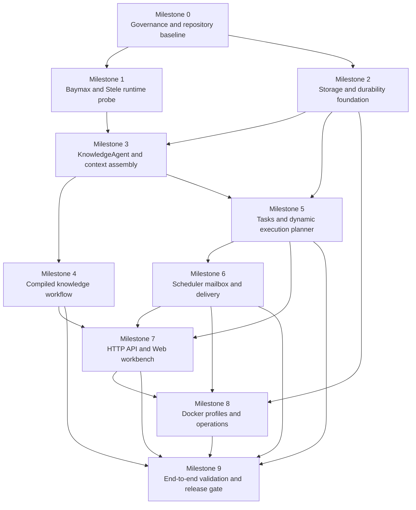

# Personal Knowledge and Task Agent Roadmap

> This roadmap turns the approved product design into a sequence of independently verifiable milestones. Each milestone produces a usable foundation for the next one. Detailed implementation plans are created separately after the milestone's scope and upstream dependencies are clear.

## Source design

The roadmap is derived from:

[Personal Knowledge and Task Agent Design](./superpowers/specs/2026-10-04-personal-knowledge-task-agent-design.md)

The project validates Baymax and Stele through real workflows. Baymax remains the Agent runtime and orchestration owner. Stele remains the context source and memory store. The application owns product entities, persistence boundaries, authorization policy, and the Web/API control surface.

## Delivery principles

1. **Runtime evidence before product breadth.** A feature is not considered integrated until its Baymax and Stele behavior is demonstrated through a deterministic test and a real OpenAI-compatible smoke run where applicable.
2. **One domain Agent, dynamic execution shape.** Query, compilation, task work, and scheduled instructions use one KnowledgeAgent domain with explicit policies. An ExecutionPlanner chooses direct, subagent, team, workflow, mailbox, or scheduled execution from the task profile.
3. **Baymax owns execution mechanics.** The application does not reimplement Baymax Run/Stream, subagent budgets, team aggregation, mailbox lifecycle, scheduler leases, Context Assembler state, or terminal-event semantics.
4. **Stele owns context continuity.** The application stores references and projections through a Stele adapter. It does not duplicate Stele internals in business modules.
5. **No production workaround for upstream defects.** A behavior that requires a Baymax or Stele change is recorded in the corresponding findings document and blocks dependent work until an upstream release or pinned reviewable commit fixes it.
6. **Durability before scale.** Cross-store boundaries use database transactions, durable outboxes, idempotency keys, manifests, and startup reconciliation before adding more Agent modes.
7. **Local-first security is explicit.** The unauthenticated MVP binds to loopback. A non-loopback deployment is rejected until an authenticated mode with authorization and request-forgery protection exists.

## Dependency map

Milestones 1 and 2 can proceed in parallel after Milestone 0. The runtime probe must complete before any feature claims Baymax/Stele integration. The storage foundation must complete before tasks, schedules, or compilation durability is implemented.

## Milestone 0 — Governance and repository baseline

**Purpose:** establish the repository structure, dependency policy, local security boundary, and evidence conventions before implementing product behavior.

**Deliverables:**

- Go module and service entry-point layout for `cmd`, `server`, `agent`, `context`, `knowledge`, `tasks`, `storage`, and `web`.
- Initial configuration model for model endpoint, Baymax/Stele versions, storage driver, data directories, listener address, scheduler, and Docker profiles.
- `docs/upstream/baymax-findings.md` and `docs/upstream/stele-findings.md` using the approved structured finding template.
- Dependency lock policy recording exact Baymax and Stele versions or commits.
- Default listener and Docker port binding set to `127.0.0.1`.
- CI skeleton for formatting, static checks, unit tests, and documentation checks.
- A small deterministic fixture corpus for documents, tasks, schedules, and Agent events.

**Entry conditions:** the approved design document is committed.

**Exit gate:**

- The repository builds with the selected Go toolchain.
- Configuration rejects non-loopback binding unless the future authenticated mode is enabled.
- The two upstream findings documents exist and define the `blocked-upstream` lifecycle.
- Dependency versions are reproducible from a clean checkout.
- No application code calls a provider SDK directly.

**Next implementation plan:** repository bootstrap and configuration boundaries.

## Milestone 1 — Baymax and Stele runtime probe

**Purpose:** prove the core dependencies can be used through their real APIs before building business features around assumptions.

**Baymax evidence:**

- A real parent Run and Stream using the configured model adapter.
- A typed local tool invocation and lifecycle event capture.
- A bounded child run through Baymax composer/subagent dispatch.
- A minimal `teams` parallel run and a vote run.
- A mailbox command publish, lease consume, ack, requeue, and dead-letter fixture.
- A scheduler lease and delayed-dispatch fixture.
- A Context Assembler projection with prefix guard, handoff digest, and derived budget view.

**Stele evidence:**

- Create and read a scoped conversation context.
- Append and query a long-term memory.
- Attach a task and run reference to context.
- Reconstruct a bounded context projection after process restart.
- Verify the idempotency behavior required for scheduled memory writes.

**Deliverables:**

- `agent/baymax` adapter with no business logic.
- `context/stele` adapter exposing domain operations only.
- Correlation model for parent run, child run, team, mailbox message, schedule occurrence, and Stele context.
- Deterministic fake-model fixtures plus an OpenAI-compatible live smoke fixture.
- First entries in upstream findings documents for any observed defect or missing contract.

**Exit gate:** all runtime paths above produce correlated evidence. If a required capability is missing or incorrect in Baymax or Stele, dependent milestones are marked `blocked-upstream` and no production workaround is added.

**Next implementation plan:** dependency adapters and integration contract tests.

## Milestone 2 — Storage and durability foundation

**Purpose:** create the persistence model needed to make compilation, scheduling, task updates, and delivery recoverable.

**Deliverables:**

- Storage interfaces and SQLite implementation.
- PostgreSQL implementation using the same repositories and migrations.
- Database migrations for conversations, tasks, schedules, executions, notifications, source metadata, knowledge generations, artifacts, manifests, revisions, idempotency records, leases, and outboxes.
- Transactional outboxes for:
  - schedule dispatch to Baymax mailbox;
  - Stele context projection;
  - Webhook delivery.
- Startup reconciliation for pending outbox rows, expired leases, incomplete materialization, and committed knowledge generations.
- A generation manifest model with a monotonic generation ID and commit marker.
- Effect-key repository for conditional idempotent mutations.

**Knowledge durability rule:** SQLite/PostgreSQL is the source of truth for committed source bytes and generated artifacts. The mounted filesystem is an input directory and derived export. Readers use committed database generations only.

**Exit gate:**

- SQLite and PostgreSQL pass the same repository contract suite.
- A crash at each documented transaction boundary leaves either the previous committed state or the complete new state.
- Outbox rows survive process restart and are safe to publish again with the same idempotency key.
- Materialization can be deleted and rebuilt from a committed generation manifest.

**Next implementation plan:** repositories, migrations, transaction boundaries, outbox workers, and reconciliation.

## Milestone 3 — KnowledgeAgent and Context Assembler integration

**Purpose:** build the unified KnowledgeAgent and ensure every parent and child receives a bounded, role-specific Stele projection through Baymax Context Assembler.

**Deliverables:**

- KnowledgeAgent construction with `read`, `write`, and `scheduled` policies.
- Server-controlled tool registration and capability checks.
- `ExecutionPlanner` interfaces for `TaskProfile`, `ExecutionPlan`, plan digest, and plan version.
- Context projection pipeline:
  - prefix baseline and capability digest;
  - Stage 2 Stele/KnowledgeStore disclosure;
  - pressure compaction and task-aware recap;
  - reference-first `handoff.v1`.
- Role-specific projections for coordinator, ContextReader, KnowledgeNavigator, SectionAnalyst, CitationValidator, and TaskMemoryInterpreter.
- Baymax event and diagnostic projection into application execution records and Stele references.
- Prompt-injection boundary tests proving untrusted data cannot authorize write tools.

**Execution modes initially supported:** `direct` and bounded `subagent_fanout`. Team, workflow, mailbox, and scheduled modes are added by later milestones after their planner contracts are in place.

**Exit gate:**

- Run and Stream produce equivalent terminal and aggregation semantics.
- A child cannot run with a different prefix or tool capability digest than its authorized parent projection.
- Context pressure preserves citations and source references.
- Stele is never copied wholesale into every child prompt.
- Untrusted document text cannot invoke memory, task, schedule, webhook, or compilation side effects.

**Next implementation plan:** unified Agent runtime, policy-controlled tools, Context Assembler adapter, and projection tests.

## Milestone 4 — Compiled knowledge workflow

**Purpose:** implement the OpenKB-inspired knowledge workbench foundation: import documents, compile durable artifacts, navigate them, and answer with citations.

**Deliverables:**

- Markdown and plain-text scanner with content hashing and incremental change detection.
- Normalizer and heading-based section-tree extraction.
- Knowledge artifacts:
  - source document;
  - summary page;
  - concept page;
  - entity page;
  - section tree;
  - knowledge index;
  - saved exploration.
- Baymax workflow for normalize → fan out section subagents → aggregate findings → validate citations → prepare plan → commit generation.
- Baymax teams parallel aggregation for independent sections and vote validation for conflicting concepts or citations.
- Database generation commit, filesystem materialization, and Stele context outbox.
- Knowledge navigation tools: index, summary, concept, entity, candidate search, and bounded source section reads.
- Citation model with source identity, section range, generation ID, and artifact lineage.

**Exit gate:**

- Two Markdown documents compile into browsable artifacts.
- Cross-document concept updates are visible and source-linked.
- A query follows index → summary/concept/entity → bounded source section and returns citations.
- Unsupported claims are rejected before commit.
- Crashing during staging or materialization never exposes a partial generation.

**Next implementation plan:** ingestion, KnowledgeStore generation model, compiler workflow, navigation tools, and citation validation.

## Milestone 5 — Tasks and dynamic execution planner

**Purpose:** support personal tasks and choose Baymax's execution shape from task characteristics at runtime.

**Deliverables:**

- Task entity with title, description, status, due time, labels, source conversation, run links, and monotonic revision.
- Conditional task mutations using `expected_revision`.
- Typed `task_revision_conflict` response and Agent re-read/replan behavior.
- TaskProfile extraction for objective, complexity, dependency graph, parallelism, evidence breadth, latency, risk, write scope, and budget.
- Deterministic planner rules and versioned ExecutionPlan:
  - `direct`;
  - `subagent_fanout`;
  - `team_parallel`;
  - `team_vote`;
  - `workflow`;
  - `mailbox_async`;
  - `scheduled`.
- Harness control loop with admission, plan notebook, checkpoints, safe-point pause, bounded retry, replan, and commit gate.
- Plan-versioned replan that reuses completed idempotent results and cannot silently expand write authority.

**Exit gate:**

- Equivalent profiles choose equivalent modes and record rationale.
- Low-complexity tasks use direct execution.
- Independent work uses subagents or parallel teams within parent budget.
- Ordered or commit-sensitive work uses workflow checkpoints.
- Long-running work uses mailbox delivery and can resume after restart.
- Concurrent stale task writes produce a revision conflict rather than lost updates.
- `input_required`, `approval_required`, and `budget_exhausted` pause reasons resume from a durable checkpoint.

**Next implementation plan:** task repositories, planner rules, plan notebook, harness controller, and concurrency tests.

## Milestone 6 — Scheduler, mailbox, and reliable delivery

**Purpose:** add fixed-action and natural-language scheduled tasks with durable dispatch, idempotent effects, explicit time semantics, and notifications.

**Deliverables:**

- Schedule definitions with cron, IANA timezone, action type, instruction/payload, enabled state, retry policy, misfire policy, and backfill limit.
- Schedule occurrence identity containing local timestamp, resolved UTC instant, tzdata version, and schedule revision.
- Baymax scheduler integration for lease, retry, QoS, delayed dispatch, and DLQ.
- Application schedule dispatch outbox and Baymax mailbox worker.
- Occurrence-scoped effect keys for every scheduled mutation.
- Conditional idempotent writes for tasks, memories, compilation, notifications, and Stele operations.
- DST behavior:
  - skip nonexistent local times;
  - select the earlier UTC instant for ambiguous local times;
  - record the decision.
- Misfire policies:
  - `skip`;
  - default `coalesce_latest`;
  - bounded `backfill`.
- Web notifications and durable Webhook delivery outbox with independent retry worker.

**Exit gate:**

- A natural-language schedule creates a real Baymax scheduled run and Stele memory.
- A fixed reminder survives scheduler and worker restart.
- Crash windows around occurrence commit and mailbox publish deliver one logical occurrence.
- Replayed scheduled side effects return the original effect result.
- DST and misfire fixtures produce stable occurrence decisions and keys.
- Webhook delivery survives a crash after execution and reports terminal failure separately from Agent success.
- Missing Stele idempotency support blocks the dependent feature rather than introducing a production workaround.

**Next implementation plan:** schedule repositories, occurrence calculator, outbox worker, mailbox worker, effect-key enforcement, and delivery worker.

## Milestone 7 — HTTP API and Web workbench

**Purpose:** expose the verified domain capabilities through a local browser workbench.

**Deliverables:**

- Loopback-only HTTP server with same-origin state-changing request checks.
- Streaming chat endpoint with typed Agent, tool, team, mailbox, planner, and citation events.
- Knowledge endpoints for directory configuration, indexing, artifact browsing, source sections, and index status.
- Task endpoints with revision-aware updates and conflict responses.
- Schedule endpoints with misfire/timezone configuration and execution history.
- Notification and Webhook delivery status views.
- Run inspector showing parent/child runs, plan versions, teams, mailbox states, leases, retries, DLQ, context projection digests, and Stele references.
- Functional OpenKB-like layout with knowledge navigation and central chat.

**Exit gate:**

- The browser can complete the documented knowledge, memory, task, schedule, notification, and citation scenarios through the API.
- Streamed events and final state agree after refresh.
- A stale UI update displays a revision conflict and cannot overwrite newer state.
- The UI cannot access the service from a non-loopback binding in the default profile.

**Next implementation plan:** API contracts, SSE/event mapping, browser state model, and workbench views.

## Milestone 8 — Docker profiles and operations

**Purpose:** make the validated local system reproducible in Docker with SQLite and PostgreSQL modes.

**Deliverables:**

- Dockerfile for the application and Web assets.
- Docker Compose default profile with SQLite and mounted data/documents directories.
- PostgreSQL profile with database health checks and migrations.
- Separate app, scheduler, mailbox/outbox, materializer, and delivery worker processes where required by the runtime contract.
- Loopback-only host port publishing.
- Shared configuration for OpenAI-compatible endpoint and model credentials through environment variables.
- Startup reconciliation and health endpoints for database, Baymax, Stele, mailbox, outboxes, and materialized knowledge generation.
- Backup/export instructions for database generations, manifests, source files, and Stele data.

**Exit gate:**

- A clean machine can start the SQLite profile with one documented command.
- The PostgreSQL profile passes the same repository and end-to-end suites.
- Restarting each worker leaves pending work recoverable.
- Deleting the derived artifact export and restarting rebuilds it from the committed generation.
- No default container port is reachable beyond the local machine.

**Next implementation plan:** container build, Compose profiles, health checks, migration startup, and recovery smoke tests.

## Milestone 9 — End-to-end validation and release gate

**Purpose:** prove the project validates Baymax and Stele in real user workflows and is ready for the next development cycle.

**Required scenario suite:**

1. Import two Markdown documents and answer a cited question.
2. Save a personal preference to Stele and retrieve it in a new conversation.
3. Create, update, and complete a task across conversations with revision checks.
4. Run a daily natural-language summary schedule and save the result to memory.
5. Execute a fixed reminder with a failing Webhook and verify independent retry status.
6. Compile a multi-section document using subagents, parallel team aggregation, citation validation, and atomic generation commit.
7. Trigger dynamic planner choices for direct, subagent, team, workflow, mailbox, and scheduled modes.
8. Pause and resume a run from a harness checkpoint.
9. Crash at every documented outbox, lease, materialization, and webhook boundary and verify recovery.
10. Run the full suite in SQLite and PostgreSQL modes.
11. Run deterministic fake-model contract tests and an OpenAI-compatible live smoke test.
12. Verify all active Baymax/Stele findings have regression fixtures and that blocked tasks remain blocked until the upstream repair is verified.

**Release gate:**

- Unit, integration, and Docker end-to-end suites pass.
- Run and Stream semantics are equivalent at terminal and aggregation boundaries.
- No unresolved `blocked-upstream` dependency is included in the claimed feature set.
- The upstream findings documents contain version, reproduction, evidence, affected task, and unblock condition for every discovered issue.
- The design's durability claims are backed by crash-recovery tests rather than only in-process tests.

## Upstream blocking policy

At every milestone, a Baymax or Stele issue that requires upstream behavior change follows this sequence:

1. Capture the exact dependency version or commit.
2. Reduce the issue to a deterministic test or fixture.
3. Record it in the correct document:
   - `docs/upstream/baymax-findings.md`
   - `docs/upstream/stele-findings.md`
4. Link the finding to every dependent roadmap task.
5. Mark those tasks `blocked-upstream`.
6. Stop dependent implementation; do not add a production workaround or silently weaken the acceptance condition.
7. Resume only after an upstream release or explicitly pinned reviewable commit is available.
8. Rerun the fixture and the affected integration suite.
9. Mark the finding `fixed-upstream` and unblock the dependent tasks only after the real integration path passes.

The only work allowed while a task is blocked is documentation, deterministic reproduction, diagnostic evidence, and tests that verify the required upstream behavior.

## How to use this roadmap

Each milestone should be executed as its own implementation plan with focused commits and a clear exit gate. The next plan is created only after the current milestone's gate passes, except for the explicitly parallel Milestone 1 and Milestone 2 work after Milestone 0.

The first implementation plan should cover Milestone 0 and Milestone 1 together only if the dependency probe can remain isolated from product code. Otherwise, complete Milestone 0 first, then create a separate Milestone 1 plan for the Baymax/Stele runtime evidence.
