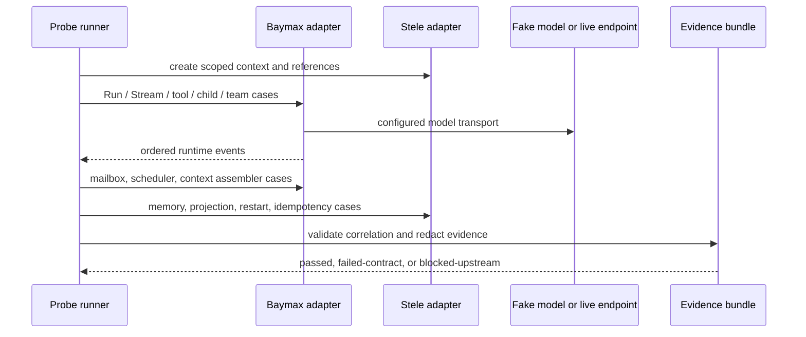

## Context

See `proposal.md` and `specs/runtime-dependency-probe/spec.md`. The project currently has the pinned Baymax and Stele modules, configuration validation, deterministic fixture support, and separate upstream findings documents, but no dependency imports or runtime evidence. The adapters must exercise the actual module APIs while avoiding a parallel orchestration, mailbox, scheduler, or context implementation.

## Goals / Non-Goals

**Goals:**

- Establish narrow adapter interfaces that map project probe inputs to real Baymax and Stele operations.
- Capture an ordered, redacted evidence bundle that is useful for both deterministic contract tests and live smoke diagnosis.
- Isolate fake model and fake clock test doubles at the adapter boundary so tests do not simulate Baymax or Stele behavior.
- Make upstream-blocking classification explicit, reproducible, and reviewable.

**Non-Goals:**

- Creating production KnowledgeAgent policies, business tools, task or schedule repositories, durable outboxes, or product HTTP endpoints.
- Reimplementing any Baymax execution primitive or Stele persistence mechanism.
- Treating an unavailable external endpoint as a dependency defect; a live smoke is skipped with a clear configured-not-run result when its explicit configuration is absent.

## Decisions

### 1. Separate adapters from probe orchestration and evidence

`internal/agent/baymax` owns translation to Baymax public APIs. `internal/context/stele` owns translation to Stele public APIs. `internal/runtimeprobe` owns probe cases, fake dependencies, evidence aggregation, redaction, and assertions. The application-facing types remain dependency-neutral: `Correlation`, `ProbeCase`, `Evidence`, `Terminal`, and `CapabilityStatus`.

This keeps future KnowledgeAgent and Context Assembler work from importing vendor types through business packages, while keeping the probe faithful to the real dependency.

**Alternative considered:** write all probes directly in tests against vendor packages. Rejected because the future product needs one inspected integration boundary and direct tests would not create a reusable correlation model.

### 2. Use deterministic contract cases before live smoke

Each probe has a deterministic fake-model or fake-clock case that drives actual Baymax and Stele adapter paths. The fake model only replaces the configured external model transport. It does not reproduce Run/Stream, child dispatch, teams, mailbox, scheduler, Context Assembler, or Stele operations. The live smoke command is opt-in and runs a small selected subset against the configured OpenAI-compatible endpoint and model.

**Alternative considered:** make all tests call a live provider. Rejected because results would be non-repeatable, credentials would be mandatory, and failures could not distinguish provider availability from dependency behavior.

### 3. Persist evidence as deterministic, redacted artifacts

Probe execution returns a structured evidence bundle that can be serialized to a test artifact under `testdata/runtimeprobe` or a run-specific diagnostics directory. Event sequence, timestamps from the fake clock, correlation IDs, dependency versions, terminal results, and capability status are captured. Prompt bodies, model credentials, authorization values, raw provider payloads, and unbounded memory content are excluded or represented by a digest.

Every non-parent object references the parent correlation ID and, where applicable, its direct parent object. Evidence validation rejects missing IDs, duplicate terminal events, non-monotonic event sequence, missing scope, and capability claims that lack evidence.

**Alternative considered:** only use test log output. Rejected because logs are weak regression inputs and do not support reviewable upstream finding records.

### 4. Model optional Baymax primitives as explicit capability results

The probe catalog contains cases for parent Run/Stream, typed tools, bounded subagents/composer, team parallel and vote, mailbox lifecycle, scheduler lifecycle, and Context Assembler. Each case reports `passed`, `failed-contract`, `skipped-unconfigured`, or `blocked-upstream`. A case is only `skipped-unconfigured` when it requires a deliberately absent live provider or optional external runtime configuration. A deterministic failure after valid local setup is `failed-contract` until triage determines whether it is an adapter defect or upstream issue.

**Alternative considered:** silently omit unsupported primitives. Rejected because it would produce a false integration claim and violates the roadmap exit gate.

### 5. Treat Stele idempotency as a required observed contract

The Stele adapter submits the same occurrence-scoped idempotency key twice and evaluates durable logical result identity and memory cardinality through the real public API. The probe does not add local deduplication. If Stele lacks the required operation or exact behavior, it produces a deterministic reproduction and blocks scheduler-dependent work.

**Alternative considered:** add an adapter-local idempotency cache. Rejected because it would mask the upstream contract required by Milestone 6 and would not survive a process restart.

### 6. Findings are evidence-led and block further dependent implementation

`internal/runtimeprobe` emits a finding candidate with exact module version, case, commands, expected and observed results, redacted evidence path, affected milestone tasks, and proposed unblock condition. Maintainers append it to the matching upstream document and set the case status to `blocked-upstream`. Subsequent apply work may add diagnostics, deterministic tests, and documentation, but cannot add an operational fallback for that missing dependency contract.

**Alternative considered:** report failures only in CI. Rejected because no durable link would exist between an upstream issue and the blocked product scope.

## Probe flow

## Risks / Trade-offs

- **[Risk] The pinned modules expose a different public API than the roadmap terminology implies.** → Start by compiling small adapter probes against the pinned APIs. Record a deterministic upstream finding only after distinguishing an integration misuse from a missing public contract.
- **[Risk] Some Baymax primitives need external brokers or storage.** → Make each precondition explicit. Test local primitives deterministically; mark only externally unconfigured live paths `skipped-unconfigured`, never as a passed capability.
- **[Risk] Live smoke can leak secrets or prompt content.** → Require explicit command activation, redact configuration and payloads at evidence construction, and test redaction with sentinel secrets.
- **[Risk] Restart behavior cannot be proven with an in-memory store.** → Use a real Stele-supported local persistence configuration for the restart case; if no supported local route exists, document and block the relevant contract.
- **[Risk] Evidence schemas drift from future runtime records.** → Keep this milestone's correlation model versioned and dependency-neutral; later persistence work maps it rather than mutating historical evidence.

## Migration Plan

1. Add dependency-neutral correlation and evidence types with validation tests.
2. Add Baymax and Stele adapter constructors that compile against the pinned modules.
3. Add deterministic probe cases incrementally, recording exact runtime evidence.
4. Add opt-in live smoke command and redaction checks.
5. Triage every failed-contract result into a local adapter correction or a documented `blocked-upstream` finding.
6. Run all deterministic contracts and the configured live smoke before claiming the Milestone 1 exit gate.

Rollback is a Git revert. The probe writes only test evidence and documented findings; it does not create product records, workers, schedules, or external side effects.

## Open Questions

None. The exact adapter calls will be resolved against the pinned module public APIs during the first compile-first probe task; an incompatibility produces recorded evidence rather than an unplanned substitute design.
